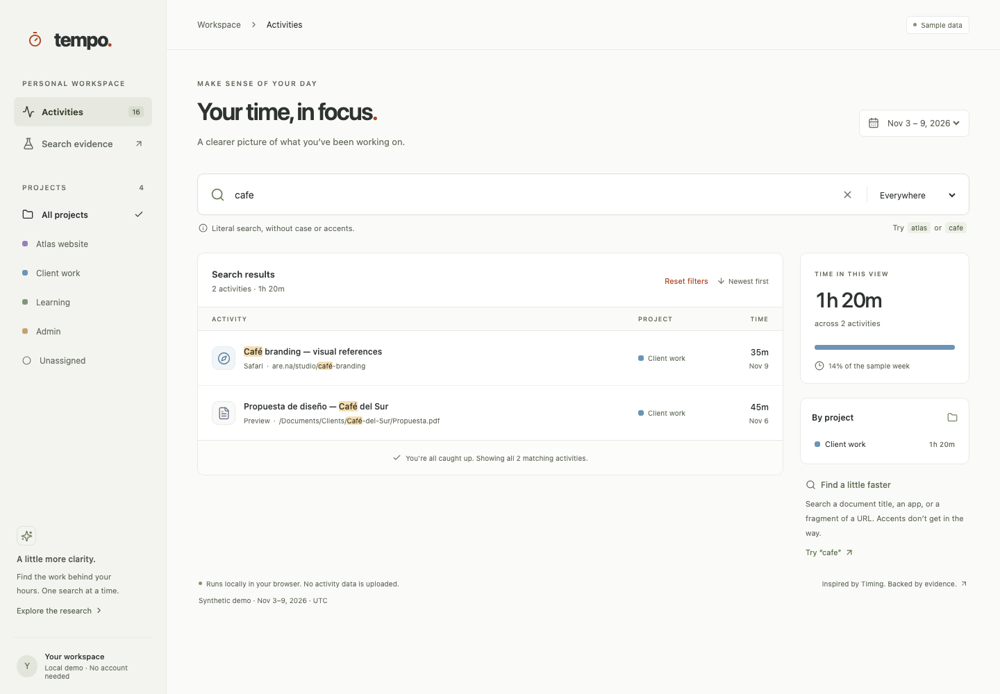

# Tempo — Timing-Inspired Activity Search

A React and TypeScript activity-search workspace inspired by research into the macOS [Timing](https://timingapp.com/) app. Tempo pairs a reusable search engine with a responsive interface and an evidence browser that distinguishes recovered behavior from implementation choices.

**This is a search prototype, not an automatic time tracker.** It uses synthetic activities, does not connect to Timing, and does not read your applications, files, or browsing history. It is not affiliated with Timing.



## Features

- Instant search across activity titles, paths and URLs, applications, and projects.
- Case- and accent-insensitive literal matching: `cafe` finds `Café`.
- Field selection plus intersecting project and date scopes.
- Original-text highlights that preserve accented characters and complete graphemes.
- Chronological results with matching activity counts, duration totals, and project breakdowns.
- Keyboard-operable activity details and helpful no-results/reset actions.
- Responsive layouts and system light/dark appearance.
- A Search Evidence page with links to original REA JSON artifacts.
- No backend, account, telemetry, or activity-data uploads.

## Getting started

Use **Node.js 24 LTS**, npm, and a modern browser with `Intl.Segmenter` support.

```sh
git clone https://github.com/fvalenzuelag/time-tracking-web.git
cd time-tracking-web
npm ci
npm run dev
```

Open the local URL printed by Vite, normally `http://localhost:5173`. The development server binds to localhost.

No environment variables, API keys, Timing installation, REA installation, or Hopper license are needed to run the web app.

### Production build

```sh
npm run build
npm run preview
```

The build is written to `dist/` and can be served by a static host. Navigation uses URL hashes, so it does not require route-specific server rewrites. Vite uses a root deployment path by default; configure its `base` before deploying under a subdirectory.

## Using search

1. Enter a query or choose a suggested search such as `atlas` or `cafe`.
2. Use **Everywhere** to search all supported fields, or select one field.
3. Select a project and date range to narrow the current view.
4. Select an activity to inspect its title, application, project, duration, start time, and path.

**Keyboard shortcuts**

- **Command-F / Control-F:** focus and select the search input while on the Activities page.
- **Escape in the search input:** clear the query without changing project, date, or field constraints.
- **Tab / Shift-Tab:** move between controls; **Enter / Space** activates focused activity buttons.

The clear button removes only query text. **Reset filters** restores all default search settings.

### Search contract

- The trimmed query is treated as **one literal substring**, not a collection of terms.
- Matching removes Unicode combining marks and ignores letter case, with Greek final-sigma normalization.
- The default field scope matches any of `title`, `path`, `application`, or `project`.
- Project selection is an exact constraint, intersected with text and date matching.
- Date bounds include the start and exclude the end. Activities are scoped by their start instant; their full duration is counted, not clipped to the date interval.
- Empty or whitespace-only queries return all activities within the selected scopes.
- Results are sorted newest first. Counts and durations are calculated from that same result set.
- Regex, boolean operators, fuzzy matching, relevance ranking, and saved rules are not implemented. Characters such as `[` and `?` are literal.

## Demo data and privacy

`src/data.ts` contains 16 synthetic activities for **November 3–9, 2026**. Dates, display times, and presets use UTC; the single-day preset is fixed to November 9, not the current day.

Search state is held in memory and resets on reload. There is no database, persistence, import flow, or automatic activity capture. To use another dataset, replace the fixtures and update the project list and date presets, or integrate the pure search module with your own data source.

Activity searches execute entirely in the browser. The app does not transmit activity data. External documentation links navigate to their respective websites when opened.

## Reusing the search engine

`src/search.ts` has no React dependency. It exports the `Activity`, `SearchOptions`, and `TextPart` types alongside:

- `searchActivities(activities, options)` — returns matching `activities`, `count`, and `durationSeconds` without mutating the input.
- `foldText(text)` — normalizes text for matching.
- `highlightMatches(text, query)` — returns original-text parts with a `matched` flag, rather than HTML.
- `formatDuration(seconds)` — formats a duration for display.

For example, from a module in the project root:

```ts
import { activities } from './src/data'
import { searchActivities } from './src/search'

const result = searchActivities(activities, {
  query: 'cafe',
  field: 'all',
  project: 'Client work',
  from: '2026-11-09T00:00:00Z',
  to: '2026-11-10T00:00:00Z',
})

console.log(result.count, result.durationSeconds)
// 1, 2100
```

Supply unique activity IDs, valid ISO timestamps with explicit time zones, and nonnegative durations in seconds. Invalid date bounds throw a `RangeError`; activities with unparseable start times are excluded.

## Evidence and limitations

Research examined **Timing 2026.6, build 595, arm64**, using REA 4.0.1 and Hopper. Open **Search evidence** in the app or inspect `evidence/` directly.

Key artifacts:

- [`search-action.json`](evidence/search-action.json): the recovered `search:` handler calls `beginSearchInteraction`.
- [`search-field-handler.json`](evidence/search-field-handler.json) and [`search-value-flow.json`](evidence/search-value-flow.json): the change-handler path reads `searchField.stringValue` and publishes it through `RxRelay.BehaviorRelay.accept`.
- [`search-cancel.json`](evidence/search-cancel.json): cancellation writes to the field; the replacement string was not conclusively recovered.
- [`search-strings.json`](evidence/search-strings.json): includes search-specific no-data guidance.
- [`database-search-strings.json`](evidence/database-search-strings.json): contains `%K CONTAINS[cd] %@`, but this predicate was **not linked to toolbar search**.

Successful analysis artifacts include evidence IDs, binary hashes, provider details, and limitations. The directory also preserves unsuccessful probes: `timing-ui.json` records unavailable native UI observation, and `ui-search-procedures.json` records a provider timeout.

**Static analysis is not runtime verification.** Timing's exact search fields, tokenization, debounce, ranking, shortcuts, and visual behavior remain unverified. Tempo's search semantics and interface are deliberate design choices, not an assertion of exact compatibility.

Official background: [Activities](https://timingapp.com/help/activities) and [Filters](https://timingapp.com/help/filters).

## Development and verification

```sh
npm run typecheck
npm run lint
npm test
npm run build
npx playwright install chromium
npm run test:e2e
npm audit
```

Build before running end-to-end tests: Playwright serves the production output on `http://localhost:4178`. That port must be available.

Unit tests cover normalization, original-text highlights, literal metacharacters, field constraints, date boundaries, ordering, and totals. Browser tests exercise search, keyboard shortcuts, filters, details, and production evidence links. They also run automated axe accessibility checks and capture search/evidence screenshots at desktop and mobile widths in light and dark modes.

Screenshots are written to `verification/`; failure traces are retained in the ignored `test-results/` directory. Automated accessibility checks do not replace manual assistive-technology testing.

## Project structure

```text
src/
  App.tsx             Activity workspace, controls, and details
  Evidence.tsx        Research findings and evidence links
  data.ts             Synthetic activities, projects, and date presets
  search.ts           Framework-independent search and highlight functions
  search.test.ts      Unit tests
  styles.css          Responsive light/dark styles
  main.tsx            React entry point
evidence/             Original analysis JSON and unsuccessful probe records
tests/                Playwright interaction and accessibility tests
verification/         Browser verification screenshots
public/               Static favicon
```

**Stack:** React 19, TypeScript, Vite, Lucide, Vitest, Playwright, axe-core, and ESLint.
